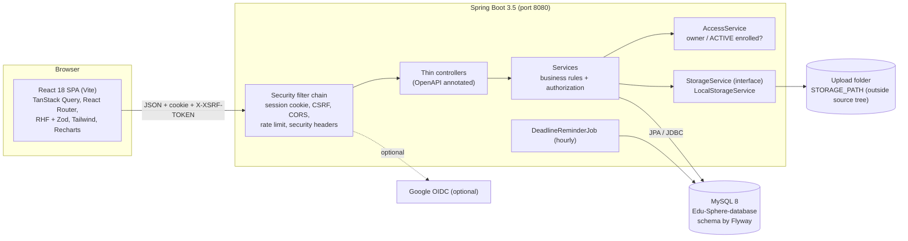

# EduSphere architecture

## Layers and rules

* **Controllers** only map HTTP to service calls. They never return JPA entities, only record DTOs.
* **Services** own the business rules **and** the authorization: every method that touches a subject calls `AccessService`
  (`requireOwnedSubject`, `requireAccess`, `requireEnrolledStudent`). Route rules in `SecurityConfig`
  (`/api/teacher/**` TEACHER, `/api/student/**` STUDENT) are only the first gate.
* **Ownership lookups return 404**, not 403, so ids cannot be probed. A student who *can see* a published subject but is not
  enrolled gets 403 "Enroll in this course" for its content.
* **Files** are stored under random names in `STORAGE_PATH`, never served statically. `GET /api/resources/{id}` checks the
  caller, then streams the file with HTTP Range support. The storage sits behind an interface so S3 can be added.
* **Transactions** live in services (never self-invoked), see `GoogleAccountService` and `AccessService`.
* **No N+1**: lists such as the catalog resolve teacher names, enrollment counts, lesson counts and the viewer's enrolled
  flags with a fixed number of queries; every growing list is paginated.
* **Time**: all instants are UTC (`DATETIME(6)`); quiz deadlines are computed on the server.

## Frontend structure

`src/features/<name>` (auth, subjects, content, learning, quizzes, assignments, community, notifications, analytics) each hold
their pages, components and a `use<Name>.js` TanStack Query hook file. Shared UI is in `src/components/ui`, layout in
`src/components/layout`. `lib/api.js` owns Axios, CSRF (`ensureCsrf`, applied automatically before every write) and `parseError`.
