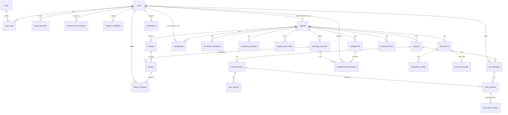

# EduSphere ER diagram

Source of truth: `backend/src/main/resources/db/migration/V1__init_schema.sql` (28 tables, owned by Flyway; Hibernate only validates).

## Key constraints (enforced by the database, not only the code)

| Rule | Constraint |
|---|---|
| One enrollment per student and subject | `UNIQUE (subject_id, student_id)` on `enrollments` |
| One quiz attempt number per student | `UNIQUE (quiz_id, student_id, attempt_no)` on `quiz_attempts` |
| One answer per question per attempt | `UNIQUE (attempt_id, question_id)` on `quiz_answers` |
| One submission per assignment and student | `UNIQUE (assignment_id, student_id)` |
| One progress row per lesson and student | `UNIQUE (lesson_id, student_id)` |
| One notification per item (reminders) | `UNIQUE (user_id, ref_key)` on `notifications` |
| Single-use tokens are never stored raw | `token_hash` = SHA-256 hex, `UNIQUE` |
| Cascading cleanup | every child table has `ON DELETE CASCADE` (or `SET NULL` for optional file links) |
